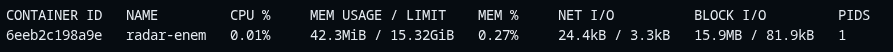
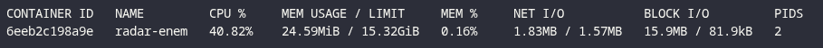
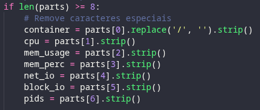
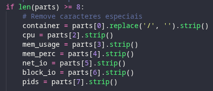

# Observações pessoais

> observações pessoais do radar enem na aula 04

## Primeira observação de uso do docker
<p align='center'>
    
</p>

| Métrica | Observação |
| --- | --- |
| `CPU` | quase nulo, sem nenhum impacto |
| `Memória` | um pouco alto pra um aplicativo que não ta fazendo nada, uso medio de 40mb |
| `Rede` | uso bem baixo, 24.4kb |
| `Block` | também um uso comum, sem nenhum impacto |

## Segunda observação de uso do docker
<p align='center'>
    
</p>

Arquivo [carga_menor](../carga_menor.py) utilizado:

| Métrica | Sem carga | Durante a carga | Interpretação |
| --- | --- | --- | --- |
| `CPU` | 0.01% | 40.82% | durante a carga a cpu foi a que mais sofreu, que teve que processar as requisições |
| `Memória` | 42.3mb | 24.59mb | Não entendi o porque que minha memória desceu em vez de subir ou estabilizar mas ok |
| `Rede` | 24.4kb | 1.83mb | Como esperado, a internet subiu o consumo, por conta das requisições online |
| `Block` | 15.9mb | 15.9mb | Como sabemos o block é o responsavel por ler e escrever no disco, como não teve que fazer nada disso, não aumentou nada |

## Terceira observação de uso do docker

Arquivo [gerar_carga.py](../gerar_carga.py) utilizado:

`OBS: o arquivo entregue pelo professor estava com o direcionamento errado, causando com que a porcentagem de cpu estivesse mostrando o nome do container ao invés da real porcentagem de uso do cpu`

<div style="display: flex; gap: 24px; align-items: center; justify-content: center; margin: 30px 0;">
  
  <div style="display: flex; flex-direction: column; align-items: center; gap: 8px;">
    
    <span style="font-weight: 500;">Antes</span>
  </div>

  <div style="font-size: 24px; color: #666; user-select: none;">-></div>

  <div style="display: flex; flex-direction: column; align-items: center; gap: 8px;">
    
    <span style="font-weight: 500;">Depois</span>
  </div>

</div>


```json
{
    "Container": "6eeb2c198a9e",
    "CPUPerc": "2.18%",
    "MemUsage": "25.03MiB / 15.32GiB",
    "MemPerc": "0.16%",
    "NetIO": "2.08MB / 1.75MB",
    "BlockIO": "15.9MB / 81.9kB",
    "PIDs": "1",
    "timestamp": "2026-08-21T10:07:32.950906",
    "timestamp_ms": 1787317652950
}
```
| Métrica | Observação |
| --- | --- |
| `CPU` | Uso normal, porcentagem bem aceitavel |
| `Memória` | Bem comum também, uso na media |
| `Rede` | Um trafego abaixo do esperado, bem comum também |
| `Block` | Sem nenhuma surpresa, bem tranquilo |

## Requisitos e Restrições do radar-enem

| Questão | Resposta |
| --- | --- |
| `Carga esperada` | Uma média de umas 5000 requisições por hora |
| `Usuarios/requisições` | Creio que uma média de 2000/3000 usuarios com 3/4 requisições por cada |
| `Disponibilidade` | 24/7 estudantes tem ansiedade severa, logo se o radar não estiver online podemos perder usuarios |
| `Crescimento dos dados` | Exponencial, conforme chegamos ao dia que saem as notas |
| `Uso constante ou sazonal` | Sazonal completamente, quando não estivermos em temporada de enem o radar ficara com um uso bem baixo, logo ja podemos pensar em algum tipo de exportação em pdf ou algo do tipo para comprovar notas |
| `Tempo de resposta aceitavel` | 1,25 segundos no maximo, como afirmei antes, estudantes são ansiosos |

## Custos

| Cenário | Preço/h | Horas/dia | Dias/mês | Custo |
| --- | --- | --- | --- | --- |
| `A` | 0,20 | 24hrs | 30 | R$144,00 |
| `B` | 0,50 | 12hrs | 15 | R$90,00 |
| `C` | 0,50 | 8hrs | 15 | R$60,00 |

Como observado, quanto menos tempo deixarmos o servidor aberto, mais viavel costuma ser, é obvio mas para observação vale a pena ver